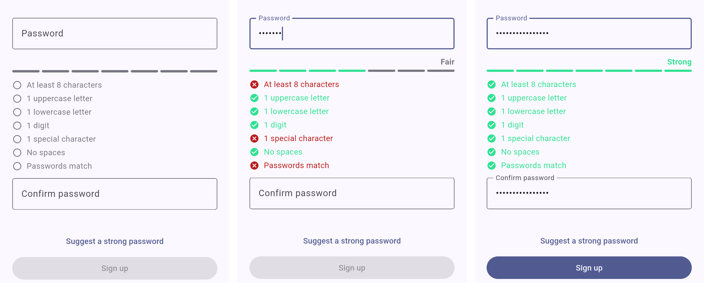

<p align="center">
  
  &nbsp;&nbsp;&nbsp;
  
</p>

<h1 align="center">flutter_pw_validator</h1>

<p align="center">
  <a href="https://pub.dev/packages/flutter_pw_validator"></a>
  <a href="https://github.com/ArefMozafari/flutter_pw_validator/actions/workflows/ci.yml"></a>
  <a href="LICENSE"></a>
</p>

Live password rules under any `TextField`: a progress bar and a checklist of
the rules still unmet, updated on every keystroke.

<p align="center">
  
</p>

## Features

- One widget under your password field, driven by the field's controller.
- Rules are a plain value, `PasswordRules` from the dependency-free
  [`password_rules`](https://pub.dev/packages/password_rules) package, so your
  Dart backend enforces the exact policy the app shows. Add your own with
  `CustomRule`, match a confirmation field with `MatchRule`, or take the NIST
  SP 800-63B-4 policy with `PasswordRules.nist()`.
- `rules.generate()` suggests a password that passes every rule.
- Unicode-aware: letters and digits from any script count, so Persian,
  Cyrillic and accented passwords are measured correctly.
- Screen readers hear each rule with whether it is met.
- Fills the available width and sizes its own height.
- Every state change animates, the widget shakes when a submit finds the
  password invalid, and both stand still when the platform asks for reduced
  motion.
- Colors and text come from your theme; every visual detail is a parameter,
  the bar comes segmented or continuous, and builders let you draw the rows
  or the bar yourself.
- Optional strength label: Weak, Fair, Good, Strong.
- Translate the labels with one constructor call; Persian ships complete.

## Install

```yaml
dependencies:
  flutter_pw_validator: ^2.0.0
```

## Use

```dart
import 'package:flutter_pw_validator/flutter_pw_validator.dart';

final controller = TextEditingController();

Column(
  children: [
    TextField(controller: controller, obscureText: true),
    const SizedBox(height: 12),
    FlutterPwValidator(
      controller: controller,
      rules: const PasswordRules(
        minLength: 8,
        uppercase: 1,
        lowercase: 1,
        digits: 1,
        special: 1,
      ),
      onSuccess: () => setState(() => canSubmit = true),
      onFail: () => setState(() => canSubmit = false),
    ),
  ],
)
```

`onChanged` runs after every change with the full `PasswordValidation`
(`isValid`, `failed`, `score`, `strength`); `onSuccess` and `onFail` run after
it for a valid or an invalid password. To validate from a button, pass a
`GlobalKey<FlutterPwValidatorState>` and call `key.currentState!.validate()`;
it repaints, fires the callbacks and returns the result.

### Rules

| Rule | Counts |
|------|--------|
| `minLength` | user-perceived characters, so an emoji sequence counts once |
| `maxLength` | the same, as an upper bound |
| `letters` | letters from any script |
| `uppercase` | uppercase letters |
| `lowercase` | lowercase letters |
| `digits` | decimal digits from any script |
| `special` | anything that is not a letter, mark, number or whitespace |
| `custom` | further rules, checked after the counts |

A count of zero disables the rule. Rules are listed in the order above, custom
ones last. `custom` takes any `PasswordRule`:

- `CustomRule(label: 'No spaces', test: hasNoSpaces)`: a label, shown as
  given, and a predicate.
- `CommonPasswordsRule()`: rejects the thousand most common leaked passwords.
- `MatchRule(() => confirmController.text)`: passes while the password equals
  the confirmation field; give the widget `listenables: [confirmController]`
  so it re-checks when that field changes.

```dart
bool hasNoSpaces(String password) => !password.contains(' ');

final rules = PasswordRules(
  minLength: 8,
  maxLength: 64,
  digits: 1,
  custom: [
    const CustomRule(label: 'No spaces', test: hasNoSpaces),
    const CommonPasswordsRule(),
    MatchRule(() => confirmController.text),
  ],
);
```

`PasswordRules.nist()` is the policy of NIST SP 800-63B-4: at least 15
characters, or 8 with `multiFactor: true`, at most 64, no composition rules,
and the common-password blocklist.

### Suggest a password

`rules.generate()` returns a random password that passes every active rule
(16 characters unless the rules need more). Put it in both fields and the
list turns green:

```dart
TextButton(
  onPressed: () {
    final password = rules.generate();
    confirmController.text = password;
    passwordController.text = password;
  },
  child: const Text('Suggest a strong password'),
)
```

### Reuse the rules in a form

`PasswordRules` works without the widget, so a `Form` or a reset-password flow
can enforce the same policy. `formValidator` returns null for a valid password
and otherwise the failing labels joined by `separator`:

```dart
const rules = PasswordRules(minLength: 8, digits: 1);

TextFormField(validator: rules.formValidator());
// 'At least 8 characters, 1 digit'

TextFormField(
  validator: rules.formValidator(
    strings: const FlutterPwValidatorStrings.persian(),
    separator: '، ',
  ),
);
```

`rules.validate(password)` gives the same result as a value when you need more
than a message.

### Enforce the same rules on the backend

`PasswordRules` lives in `package:password_rules`, which has no Flutter
dependency. Depend on it from your Dart server and share the value:

```dart
import 'package:password_rules/password_rules.dart';

final validation = rules.validate(body['password'] as String);
if (!validation.isValid) {
  return Response.badRequest(
    body: validation.failed.map(const PasswordRuleStrings().of).join(', '),
  );
}
```

### Customize

| Parameter | Default |
|-----------|---------|
| `defaultColor` | `colorScheme.outline`, used while the field is empty |
| `successColor` | the green of version 1 |
| `failureColor` | `colorScheme.error` |
| `textStyle` | `textTheme.bodyMedium` |
| `padding` | `EdgeInsets.zero` |
| `spacing` | `12`, between the bar and the list |
| `barThickness` | `4` |
| `barStyle` | `PasswordBarStyle.segments`; `continuous` is one track that fills with the score and shifts from the failure to the success color |
| `showBar`, `showList` | `true` |
| `showStrengthLabel` | `false` |
| `shakeOnInvalid` | `true`; `validate()` from a key shakes the widget when the password is invalid, typing never does |
| `listenables` | `[]`; other controllers that should trigger a re-check, such as a confirmation field |
| `neutralIcon`, `successIcon`, `failureIcon` | `Icons.radio_button_unchecked`, `Icons.check_circle`, `Icons.cancel` |
| `animationDuration` | `200ms`; zero when the platform disables animations |
| `itemBuilder`, `barBuilder` | `null`, the default row and bar |
| `strengthOf` | `null`, the share of passing rules |

### Strength label

With `showStrengthLabel: true` a label above the bar names how much of the
rules the password satisfies: `Weak` below half, `Fair` from half, `Good` from
three quarters, `Strong` when every rule passes. In code the same is
`validation.strength`, and `validation.score` is the share from 0.0 to 1.0.

The package rates by rules only. To rate by entropy, pass `strengthOf` and map
an estimator such as `zxcvbnm` or `password_strength` onto the four levels:

```dart
FlutterPwValidator(
  controller: controller,
  rules: rules,
  showStrengthLabel: true,
  strengthOf: (password, validation) {
    final entropy = estimatePasswordStrength(password); // password_strength
    if (entropy < 0.3) return PasswordStrength.weak;
    if (entropy < 0.6) return PasswordStrength.fair;
    if (entropy < 0.8) return PasswordStrength.good;
    return PasswordStrength.strong;
  },
)
```

### Draw your own rows or bar

`itemBuilder` receives a `PasswordRuleItem` with the rule (a `CountRule`
carries its `count`), its label and its status (`neutral`, `passed` or
`failed`). `barBuilder` receives the number of passing rules and the number of
active rules. A built row owns its own semantics.

```dart
FlutterPwValidator(
  controller: controller,
  rules: rules,
  itemBuilder: (context, item) => Chip(
    label: Text(item.label),
    backgroundColor: switch (item.status) {
      PasswordRuleStatus.neutral => null,
      PasswordRuleStatus.passed => Colors.green.shade100,
      PasswordRuleStatus.failed => Colors.red.shade100,
    },
  ),
  barBuilder: (context, passed, total) =>
      LinearProgressIndicator(value: passed / total),
)
```

### Translate

Each label is a function of the required count, so plurals and digit shapes
are yours to decide. Rules you do not override keep their English label.
`ruleMet` and `ruleNotMet` are what screen readers hear after a label.

```dart
FlutterPwValidator(
  controller: controller,
  rules: rules,
  strings: FlutterPwValidatorStrings(
    minLength: (count) => 'Mindestens $count Zeichen',
    digits: (count) => '$count ${count == 1 ? 'Ziffer' : 'Ziffern'}',
    strength: (strength) => switch (strength) {
      PasswordStrength.weak => 'Schwach',
      PasswordStrength.fair => 'Ausreichend',
      PasswordStrength.good => 'Gut',
      PasswordStrength.strong => 'Stark',
    },
    ruleMet: 'erfüllt',
    ruleNotMet: 'nicht erfüllt',
  ),
)
```

Persian ships complete, with Persian digits:

```dart
FlutterPwValidator(
  controller: controller,
  rules: rules,
  strings: const FlutterPwValidatorStrings.persian(),
)
```

`FlutterPwValidatorStrings` is the name this package keeps for
`PasswordRuleStrings` from `package:password_rules`; both work.

## Previews

`example/lib/previews.dart` declares `@Preview` functions for the empty,
partial, valid, continuous, Persian and dark states. Open it with the Flutter
widget previewer in your IDE, or run `flutter widget-preview start` inside
`example/`.

## Migrate from 1.x

| 1.x | 2.0 |
|-----|-----|
| `minLength:`, `normalCharCount:`, `uppercaseCharCount:`, `lowercaseCharCount:`, `numericCharCount:`, `specialCharCount:` | `rules: PasswordRules(minLength:, letters:, uppercase:, lowercase:, digits:, special:)` |
| `width:`, `height:` | removed; wrap in a `SizedBox` to constrain |
| `onSuccess:` required | optional |
| `class MyStrings implements FlutterPwValidatorStrings` with `"- Uppercase letter"` | `FlutterPwValidatorStrings(uppercase: (count) => '$count uppercase letters')` |
| `GlobalKey<FlutterPwValidatorState>` and `validate()` | unchanged |

## Example

The [example app](example/lib/main.dart) is a sign-up screen with a password
field, a confirmation field, a button that fills both with a generated
password, and a submit button enabled only while every rule passes.

```sh
cd example
flutter run
```

## Contributing

See [CONTRIBUTING.md](CONTRIBUTING.md). CI runs `dart format`,
`flutter analyze`, `flutter test` and a publish dry run on every pull request.

## License

[MIT](LICENSE)
